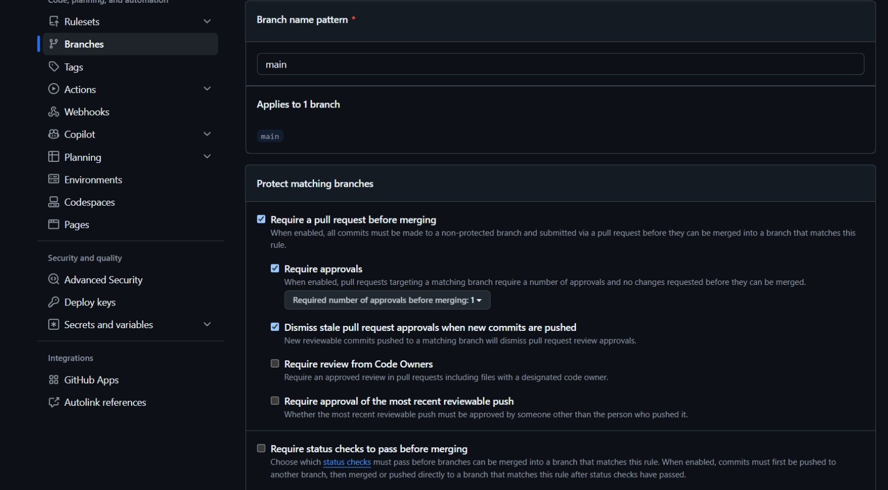
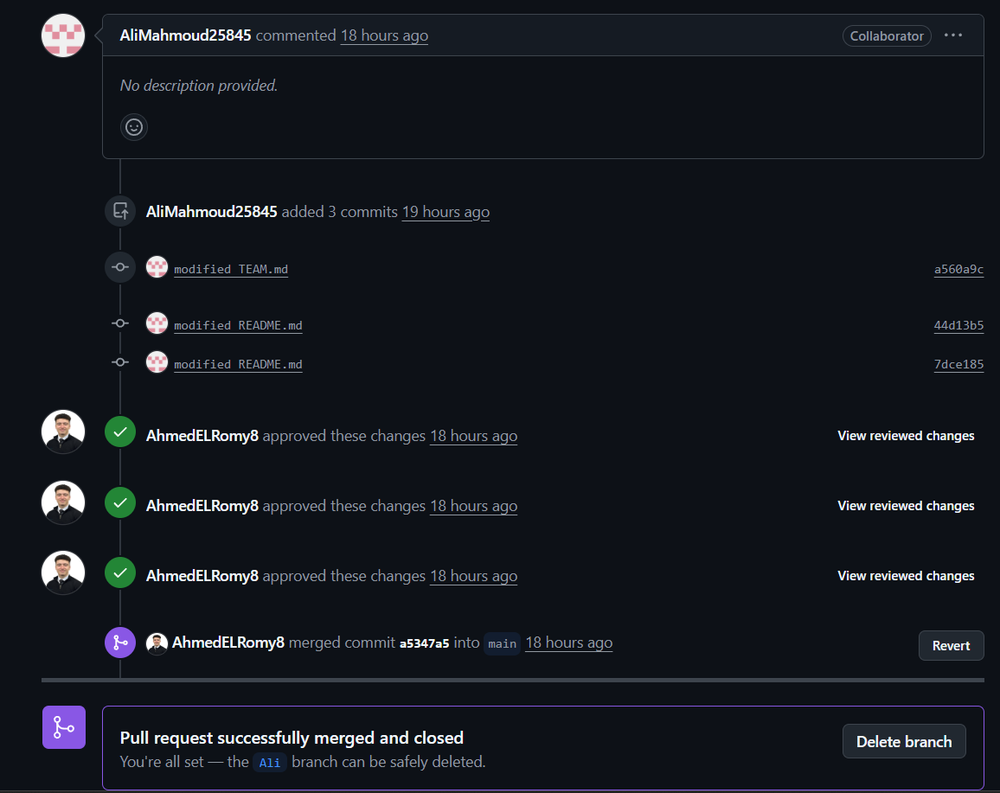

# Lab 01 Report: Branch Protection, Pull Requests & Merge Conflict

**Course:** Software Engineering – Practical Lab 01  
**Project Name:** PharmaSys  
**Project Type:** SaaS Pharmacy Management Platform  
**Project Status:** In Progress (Sprint 0 - Bootstrap)  
**Repository:** [https://github.com/AhmedELRomy8/PharmaSys](https://github.com/AhmedELRomy8/PharmaSys)  
**Instructor:** Prof. Dr. Amr Abohany  
**Faculty:** Faculty of Computers and Information, Damanhour University  

---

## 1. Introduction

This report documents the team's GitHub collaboration activities for Lab 01. The team configured a branch protection rule for the `main` branch, created pull requests for team contributions, and created and resolved a merge conflict in `README.md`.

## 2. Branch Protection

A branch protection rule was configured for the `main` branch with the following settings:

- **Branch name pattern:** `main`
- **Require a pull request before merging:** Enabled
- **Require approvals:** Enabled
- **Required number of approvals:** 1
- **Dismiss stale pull request approvals when new commits are pushed:** Enabled

These settings are intended to ensure that changes are reviewed before they are merged into `main`, rather than being committed directly to the main branch.

### Screenshot 1: Branch Protection Rule

## 3. Pull Requests by Team Members

Every team member contributed through pull requests rather than relying on one person to submit all changes. The GitHub Pull Requests page shows closed pull requests, all marked as merged:

| PR | Title | Author | Reviewer (Approved) | Result |
|---|---|---|---|---|
| #15 | modified | AhmedELRomy8 | AliMahmoud25845 | Merged |
| #16 | modified | AhmedELRomy8 | AliMahmoud25845 | Merged |
| #17 | modified TEAM.md | AliMahmoud25845 | AhmedELRomy8 | Merged |
| #18 | modified TEAM.md | AbdelrahmanMahmoud312005 | AhmedELRomy8 | Merged |
| #19 | modified TEAM.md | AliMahmoud25845 | AhmedELRomy8 | Merged |
| #20 | modified READM.md | AhmedELRomy8 | AliMahmoud25845 | Merged |
| #21 | modified TEAM.md | AliMahmoud25845 | AhmedELRomy8 | Merged |
| #22 | Ali | AliMahmoud25845 | AhmedELRomy8 | Merged |

The screenshot confirms that the repository has closed pull requests and that each listed pull request was merged. It also shows contributions from three different authors (AhmedELRomy8, AliMahmoud25845, and AbdelrahmanMahmoud312005).

### Screenshot 2: All Pull Requests

## 4. Merge Conflict: How It Was Created

A merge conflict was created in `README.md` when two branches changed the project file concurrently:

- **Branch `ahmed` (PR #20):** Ahmed modified `README.md` to update the academic year (`2027`) and merged it into `main`.
- **Branch `Ali` (PR #21):** Ali worked on branch `Ali` concurrently from an earlier commit and modified `README.md`.

When PR #20 was merged into `main`, branch `Ali` diverged from `main`. GitHub could not choose the correct version automatically and reported a conflict in `README.md`, preventing the pull request from merging.

### Screenshot 3: GitHub Detected the Conflict

## 5. How the Conflict Was Resolved

1. GitHub showed that the pull request had conflicts in `README.md` and prevented merging until the conflict was resolved.
2. The team merged `main` into branch `Ali` to resolve the conflict.
3. The conflicting content was reviewed, accepting the incoming changes (`2027`) and adding the conflict resolution documentation note in `README.md`.
4. The conflict markers (`<<<<<<<`, `=======`, and `>>>>>>>`) were removed from the resolved file.
5. The file was marked as resolved and committed (`7dce185` / `44d13b5`).
6. The pull request was reviewed and approved by peer reviewer **AhmedELRomy8**.
7. The pull request was successfully merged and closed into `main`.

### Screenshot 4: Pull Request Successfully Merged

The screenshot shows the resolution commits, peer review approvals from **AhmedELRomy8**, and GitHub's confirmation: **“Pull request successfully merged and closed. You're all set — the Ali branch can be safely deleted.”**

## 6. Conclusion

The team practiced collaborative development using GitHub by configuring a branch protection rule, submitting changes through pull requests, and resolving a merge conflict in `README.md`. The Pull Requests page shows eight merged pull requests from team members. These practices improve collaboration and make project changes easier to review and trace.

## Appendix: Suggested Note for README.md

During Lab 01, the team created and merged pull requests for changes to `TEAM.md` and `README.md`. A merge conflict occurred in `README.md` because the `ahmed` and `Ali` branches modified `README.md` concurrently. We resolved the conflict by merging `main`, selecting the intended final content, and removing conflict markers. After committing the resolution and receiving peer review approval from AhmedELRomy8, the pull request was successfully merged into `main`.
