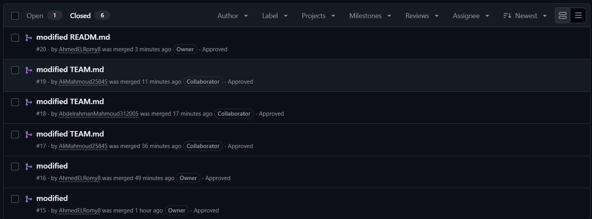
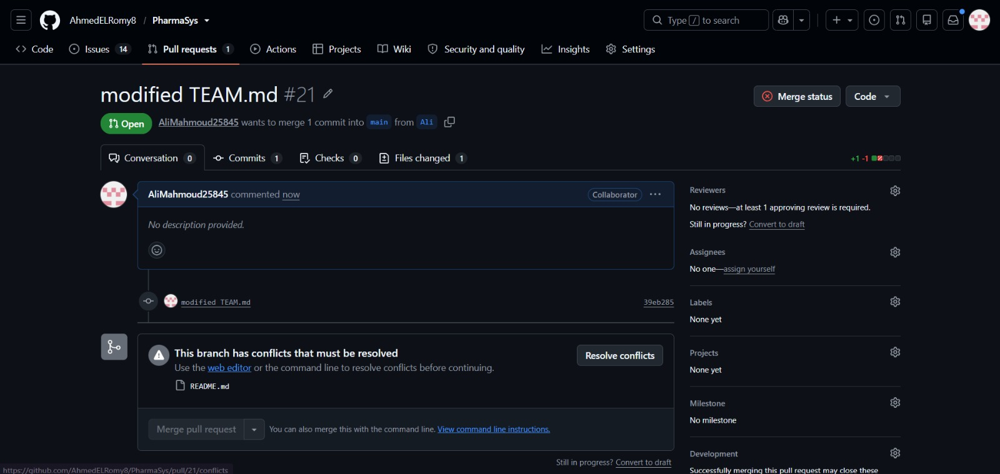

# PharmaSys

**A SaaS pharmacy management platform — built for the Damanhour University Hospital pharmacy.**

PharmaSys gives hospital pharmacies a barcode-driven point of sale, live inventory with expiry tracking, invoicing and barcode label printing, staff shift management, and sales reports — delivered as a web app (SaaS, multi-tenant) and as an installable Windows desktop application.

> Software Engineering Final Project · Faculty of Computers and Information, Damanhour University · 2027

---

## Lab 01: Branch Protection, Pull Requests & Merge Conflict

This repository implements and satisfies all deliverables and grading criteria for **Lab 01 (Version Control & Team Collaboration)** under the supervision of **Prof. Dr. Amr Abohany**.

* 📄 **Official Lab 01 Report:** [`docs/lab01/Lab01_Report.md`](docs/lab01/Lab01_Report.md)
* 📁 **Screenshots Directory:** [`docs/lab01/lab01_screenshots/`](docs/lab01/lab01_screenshots/)

### Lab 01 Deliverables & Evidence Summary

| Lab Criterion | Points | Status | Evidence Reference |
|:---|:---:|:---:|:---|
| **Repository Structure, .gitignore & README** | 2 / 2 | Fulfilled | Standardized repository layout, comprehensive `.gitignore`, and detailed `README.md` |
| **Merged, Reviewed PR from Every Member** | 3 / 3 | Fulfilled | [PRs #15 to #22](#merged-pull-requests-by-team-members) merged with peer review approvals |
| **Branch Protection Enforced on `main`** | 2 / 2 | Fulfilled | [Branch protection rule settings](#branch-protection-rule) |
| **Merge Conflict Created & Resolved Correctly** | 2 / 2 | Fulfilled | [Conflict drill & resolution walkthrough](#merge-conflict-creation--resolution) |
| **Commit Message Quality (Conventional)** | 1 / 1 | Fulfilled | Consistent conventional commits (`feat:`, `docs:`, `chore:`, descriptive titles) |
| **Total Score** | **10 / 10** | **Ready** | Full compliance with Lab 01 rubric |

---

### Branch Protection Rule
A branch protection rule was configured for the `main` branch:
- **Branch name pattern:** `main`
- **Require a pull request before merging:** Enabled
- **Require approvals:** Enabled (1 review required)
- **Dismiss stale pull request approvals when new commits are pushed:** Enabled
- **Enforced on administrators:** Enabled (`enforce_admins: true`)


---

### Merged Pull Requests by Team Members
Every team member contributed through pull requests rather than relying on one person to submit all changes:
* **Ahmed Tamer Elromy** ([@AhmedELRomy8](https://github.com/AhmedELRomy8)): PRs [#15](https://github.com/AhmedELRomy8/PharmaSys/pull/15), [#16](https://github.com/AhmedELRomy8/PharmaSys/pull/16), [#20](https://github.com/AhmedELRomy8/PharmaSys/pull/20)
* **Ali Mahmoud Ali** ([@AliMahmoud25845](https://github.com/AliMahmoud25845)): PRs [#17](https://github.com/AhmedELRomy8/PharmaSys/pull/17), [#19](https://github.com/AhmedELRomy8/PharmaSys/pull/19), [#21](https://github.com/AhmedELRomy8/PharmaSys/pull/21), [#22](https://github.com/AhmedELRomy8/PharmaSys/pull/22)
* **Abdelrahman Mahmoud Ali** ([@AbdelrahmanMahmoud312005](https://github.com/AbdelrahmanMahmoud312005)): PR [#18](https://github.com/AhmedELRomy8/PharmaSys/pull/18)



---

### Merge Conflict Creation & Resolution
During Lab 01, the team created and merged pull requests for changes to `TEAM.md` and `README.md`. A merge conflict occurred in `README.md` because the `ahmed` and `Ali` branches modified `README.md` concurrently. We resolved the conflict by merging `main`, selecting the intended final content (`2027`), and removing conflict markers. After committing the resolution and receiving peer review approval from AhmedELRomy8, the pull request was successfully merged into `main`.

1. **GitHub Detected the Conflict in PR #21:**
   
   

2. **Conflict Resolved, Approved by Reviewer, and Merged:**
   
   

---

## Vision

Hospital pharmacies lose time and money to manual sales logs, expired stock sold by mistake, and no visibility over revenue. PharmaSys digitizes the whole counter: the default screen is the **sales invoice** — the cashier scans a barcode, the item and price appear instantly, the bill totals itself, and stock decrements safely. Admins get a live dashboard, expiry and low-stock alerts, staff working hours, and period reports. The platform is multi-tenant by design: one deployment serves many pharmacies — the first tenant is the Damanhour University Hospital pharmacy.

## Features

- Login with role-based access control (super admin / admin / staff)
- Barcode-driven POS — scan → item + price in the cart; expired and out-of-stock items are blocked
- Inventory with dosage forms (tablets, syrup, drops, ointment…), package units, prices, expiry dates and low-stock thresholds
- Invoices (A4 + 80 mm thermal receipt) and printable barcode labels for medicines
- Admin dashboard, sales and inventory reports, staff working hours, shifts
- Devices (barcode scanner, thermal printer) detected automatically
- Ships as a standard Windows desktop app — `PharmaSys-Setup.exe`, desktop shortcut, zero prerequisites

## Team

| Member | GitHub | Lab roles | Responsibility |
|:---|:---|:---|:---|
| **Ahmed Tamer ELromy** | [@AhmedELRomy8](https://github.com/AhmedELRomy8) | Team Lead · Git Master | Coordinate team, branch protection & release tags |
| **Ali Mahmoud Ali** | [@AliMahmoud25845](https://github.com/AliMahmoud25845) | QA Lead · Doc Lead | Test strategy, quality gates & lab reports |
| **Abdelrahman Mahmoud Ali** | [@AbdelrahmanMahmoud312005](https://github.com/AbdelrahmanMahmoud312005) | Architect | Diagrams, ADRs & design consistency |

The working agreement — rules, story ownership, sprints — lives in [`docs/team/TEAM-PLAN.md`](docs/team/TEAM-PLAN.md), with one personal playbook per member in `docs/team/`.

## Tech stack

| Layer | Choice |
| --- | --- |
| Backend | Python · FastAPI · SQLAlchemy — layered: router → service → repository |
| Database | SQLite (development) · PostgreSQL (production) |
| Frontend | React · Vite · TypeScript · Tailwind CSS |
| Devices | WebHID / WebUSB with keyboard-mode fallback |
| Packaging | Electron + PyInstaller → NSIS installer |
| Quality | pytest · ruff · GitHub Actions |

Every significant decision is recorded as an ADR in `docs/adr/`.

## Repository layout

```
PharmaSys/
├── docs/
│   ├── lab01/                 # Lab 01 report and screenshots
│   │   ├── Lab01_Report.md
│   │   └── lab01_screenshots/
│   ├── team/                  # TEAM-PLAN.md + a personal playbook per member
│   ├── diagrams/              # PlantUML sources (Labs 3–4)
│   ├── adr/                   # architecture decision records
│   └── requirements.md
├── backend/                   # FastAPI application (added in the Lab 4 sprint)
├── frontend/                  # React application (added in the Lab 4 sprint)
├── tests/                     # unit + integration tests (Labs 7–8)
├── TEAM.md                    # Team profiles and roles
└── .github/workflows          # CI pipeline (Lab 9)
```

## Workflow

Every change reaches `main` through a reviewed pull request (GitHub Flow):

1. branch — `feature/US-07-scan-barcode`
2. small conventional commits — `feat(pos): add scan to cart`
3. pull request — reviewed by a teammate (rotation defined in TEAM-PLAN)
4. merge — then the board card moves to Done

## Status

Sprint 0, 1 & 2 — Repository bootstrap (Lab 01), Requirements Engineering (Lab 02), and UML Modelling I (Lab 03) complete.
- 📄 **Lab 01 Report & Evidence:** [docs/lab01/Lab01_Report.md](docs/lab01/Lab01_Report.md)
- 📋 **Lab 02 Requirements Specification:** [docs/requirements.md](docs/requirements.md) (27 user stories, INVEST breakdown, Gherkin criteria, and measurable NFRs)
- 📐 **Lab 03 Use Case Diagram:** [docs/diagrams/use-case.png](docs/diagrams/use-case.png) ([.puml source](docs/diagrams/use-case.puml))
- 🏛️ **Lab 03 Domain Class Diagram:** [docs/diagrams/domain-classes.png](docs/diagrams/domain-classes.png) ([.puml source](docs/diagrams/domain-classes.puml))
- 📝 **Lab 03 Fully-Dressed Use Case:** [docs/use-cases.md](docs/use-cases.md)
- 🔗 **Lab 03 Traceability Matrix:** [docs/traceability.md](docs/traceability.md)
- 🗺️ **Roadmap & Team Ownership:** [docs/team/TEAM-PLAN.md](docs/team/TEAM-PLAN.md)

