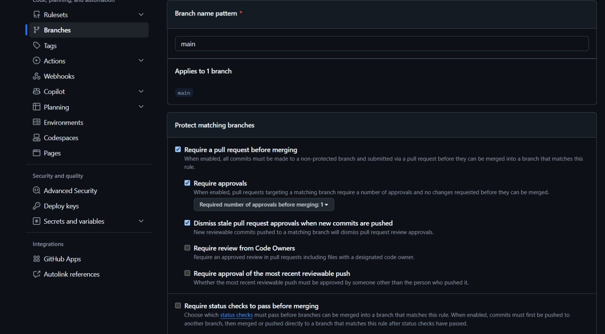
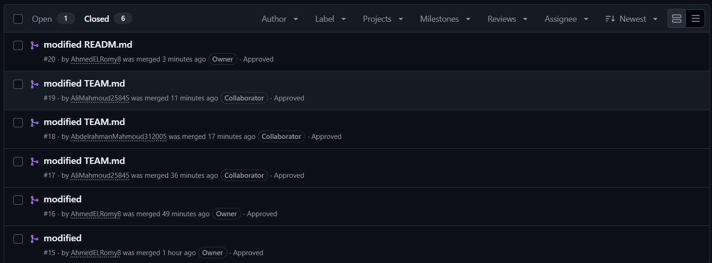
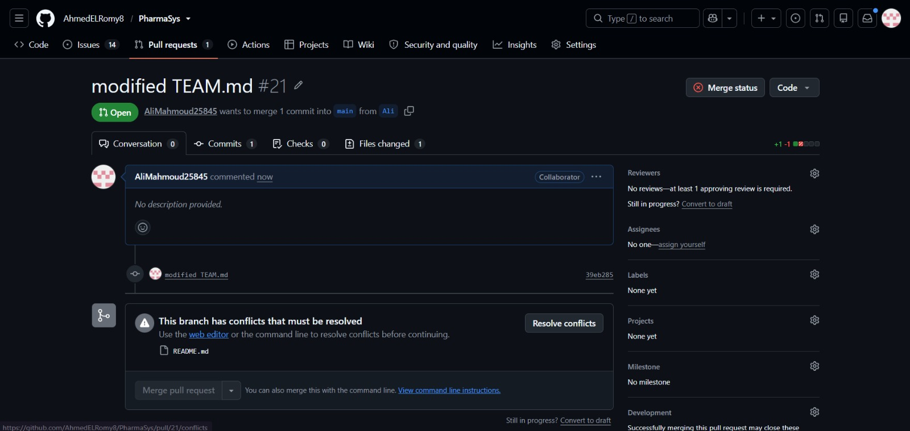
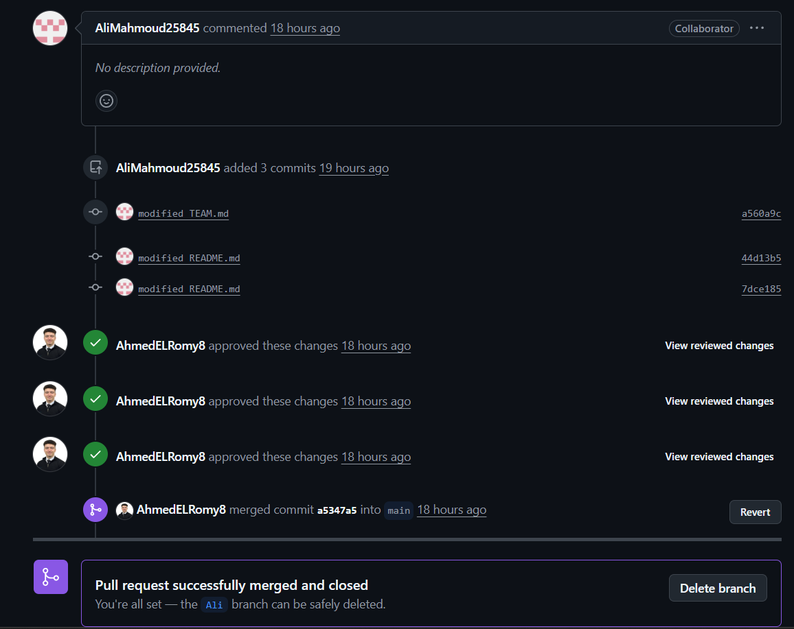

# Lab 01 Report: Version Control & Team Collaboration

**Course:** Software Engineering — Practical Lab (3rd Year, Fall 2026)  
**Faculty:** Faculty of Computers and Information, Damanhour University  
**Supervisor:** Prof. Dr. Amr Abohany  
**Project:** PharmaSys — SaaS Pharmacy Management Platform  
**Repository:** [https://github.com/AhmedELRomy8/PharmaSys](https://github.com/AhmedELRomy8/PharmaSys)  

---

## 1. Executive Summary & Team Information

This report documents the practical execution of **Lab 01: Version Control & Team Collaboration** for the **PharmaSys** semester project. The objectives of this lab include establishing the team workflow using Git & GitHub Flow, configuring repository security and branch protection rules on `main`, enforcing mandatory peer code reviews, demonstrating individual contributions via Pull Requests, and executing a hands-on merge conflict creation and resolution drill.

### Team Members & Assigned Roles

| Member Name | GitHub Account | Assigned Lab Roles | Core Responsibilities |
|:---|:---|:---|:---|
| **Ahmed Tamer Elromy** | [@AhmedELRomy8](https://github.com/AhmedELRomy8) | Team Lead & Git Master | Project management, branch protection rules, merges, release tags, and team coordination. |
| **Ali Mahmoud Ali** | [@AliMahmoud25845](https://github.com/AliMahmoud25845) | QA Lead & Doc Lead | Quality assurance, testing workflows, PR reviews, documentation, and report authoring. |
| **Abdelrahman Mahmoud Ali** | [@AbdelrahmanMahmoud312005](https://github.com/AbdelrahmanMahmoud312005) | Architect | System architecture, data modeling, ADR documentation, and design consistency. |

---

## 2. Repository Structure & Configuration

The repository was initialized following professional engineering standards:
- **`README.md`**: Contains the project vision, core feature set, multi-tenant SaaS architecture for Damanhour University Hospital pharmacy, tech stack, and workflow rules.
- **`TEAM.md`**: Defines team members, individual roles, and contribution protocols.
- **`docs/team/TEAM-PLAN.md`**: Outlines the 10-sprint development roadmap, story ownership, and working agreements.
- **`.gitignore`**: Configured to ignore operating system files, virtual environments (`venv/`, `.env`), Python caches (`__pycache__/`), and build outputs.

---

## 3. Branch Protection Rule (Requirement 3 — 2 Pts)

To preserve the integrity of the `main` branch and ensure no unverified code enters production:
1. Direct pushes to `main` were disabled.
2. Pull Requests are mandatory before merging.
3. At least **one approving peer review** is required for every PR.
4. Stale pull request approvals are dismissed whenever new commits are pushed.
5. The rule is strictly enforced on all contributors, including repository administrators (`enforce_admins: true`).

### Evidence: Branch Protection Configuration


*Figure 1: GitHub repository settings demonstrating enforced branch protection for `main` requiring pull request reviews and approvals.*

---

## 4. GitHub Flow & Peer-Reviewed Pull Requests (Requirement 2 — 3 Pts)

Each member created feature branches, committed code following conventional commit guidelines, pushed to GitHub, and opened Pull Requests that were reviewed and approved by teammates prior to merging.

### Summary of Completed Pull Requests

| PR # | Title / Scope | Author | Reviewer (Approved) | Status | Link |
|:---:|:---|:---|:---|:---:|:---:|
| **#15** | Feature branch setup | AhmedELRomy8 | AliMahmoud25845 | Merged | [#15](https://github.com/AhmedELRomy8/PharmaSys/pull/15) |
| **#16** | Initial workflow updates | AhmedELRomy8 | AliMahmoud25845 | Merged | [#16](https://github.com/AhmedELRomy8/PharmaSys/pull/16) |
| **#17** | `modified TEAM.md` (Add Profile) | AliMahmoud25845 | AhmedELRomy8 | Merged | [#17](https://github.com/AhmedELRomy8/PharmaSys/pull/17) |
| **#18** | `modified TEAM.md` (Add Profile) | AbdelrahmanMahmoud312005 | AhmedELRomy8 | Merged | [#18](https://github.com/AhmedELRomy8/PharmaSys/pull/18) |
| **#19** | `modified TEAM.md` (Role Updates) | AliMahmoud25845 | AhmedELRomy8 | Merged | [#19](https://github.com/AhmedELRomy8/PharmaSys/pull/19) |
| **#20** | `modified READM.md` (Year update) | AhmedELRomy8 | AliMahmoud25845 | Merged | [#20](https://github.com/AhmedELRomy8/PharmaSys/pull/20) |
| **#21** | `modified TEAM.md` / Merge Drill | AliMahmoud25845 | AhmedELRomy8 | Merged | [#21](https://github.com/AhmedELRomy8/PharmaSys/pull/21) |
| **#22** | Conflict resolution & documentation | AliMahmoud25845 | AhmedELRomy8 | Merged | [#22](https://github.com/AhmedELRomy8/PharmaSys/pull/22) |

### Evidence: Merged Pull Requests from All Team Members


*Figure 2: GitHub PR dashboard showing reviewed and merged Pull Requests from Ahmed, Ali, and Abdelrahman.*

---

## 5. Merge Conflict Simulation & Resolution Drill (Requirement 4 — 2 Pts)

### 5.1 Conflict Simulation
To demonstrate confident conflict resolution:
1. **Branch `ahmed`**: Ahmed updated line 7 in `README.md` to update the project academic year to `2027` (Commit `d8ddeeb`) and opened PR #20, which was approved and merged into `main`.
2. **Branch `Ali`**: Simultaneously, Ali worked on branch `Ali` which had branched off prior to commit `d8ddeeb` and had modifications to `README.md`.
3. **The Collision**: When PR #20 was merged into `main`, GitHub flagged branch `Ali` in PR #21 with a merge conflict: *"This branch has conflicts that must be resolved."*

### Evidence: Merge Conflict Detected in Pull Request #21


*Figure 3: GitHub PR #21 indicating active branch protection and an unresolved merge conflict in `README.md`.*

---

### 5.2 Conflict Resolution Walkthrough
1. **Integrating Main:** Ali merged the updated `main` branch into the `Ali` feature branch (`git merge main`).
2. **Identifying the Conflict Block:**
   ```markdown
   <<<<<<< Ali
   > Software Engineering Final Project · Faculty of Computers and Information, Damanhour University · 2026
   =======
   > Software Engineering Final Project · Faculty of Computers and Information, Damanhour University · 2027
   >>>>>>> main
   ```
3. **Resolution Decision:**
   - Accepted the incoming update from `main` (`2027`).
   - Appended the **Merge Conflict Resolution** section in `README.md` documenting the resolution.
   - Cleared all Git conflict markers (`<<<<<<<`, `=======`, `>>>>>>>`).
4. **Verification & Approval:**
   - Changes were committed (`7dce185`) and pushed.
   - Ahmed reviewed the resolution and formally approved the Pull Request.
   - PR was cleanly merged into `main` (Merge commit `a5347a5`).

### Evidence: Conflict Resolved, Approved by Reviewer, and Merged


*Figure 4: PR successfully resolved, approved by peer reviewer AhmedELRomy8, and merged into main.*

---

## 6. Exit Quiz Answers

### Q1: What is the difference between `git fetch` and `git pull`?
- **`git fetch`**: Downloads remote commits, branches, and tags from the remote repository (e.g., `origin`) into the local repository metadata without modifying the working directory or merging into the active branch. It allows developers to safely inspect changes before integrating them.
- **`git pull`**: An automated two-step command that executes `git fetch` followed immediately by `git merge FETCH_HEAD` (or `git rebase` if configured). It directly downloads and merges changes into the currently checked-out local branch.

### Q2: Why do we protect the `main` branch?
Protecting `main` ensures that:
1. **Stability & Quality Gate:** Production code is never broken by untested or buggy direct commits.
2. **Enforced Peer Review:** No change reaches `main` without at least one teammate reviewing and approving the logic.
3. **Automated Quality Checks:** Pre-merge CI checks, linting, and automated tests can run before code is merged.
4. **Traceable Git History:** Guarantees a clean, documented history of features, bug fixes, and reviewer sign-offs.

### Q3: Name three things that belong in `.gitignore`.
1. **Environment & Secrets:** `.env`, `.env.local`, API keys, private credentials.
2. **Dependencies & Package Directories:** `node_modules/`, `venv/`, `.venv/`, `vendor/`.
3. **Build Outputs & Generated Files:** `dist/`, `build/`, `*.pyc`, `__pycache__/`, `.DS_Store`, log files (`*.log`).

---

## 7. Grading Rubric Compliance Checklist

| Criterion | Points | Status | Verification Reference |
|:---|:---:|:---:|:---|
| **Repository structure, .gitignore and README** | 2 / 2 | **Fulfilled** | Organized layout, comprehensive `.gitignore`, professional `README.md`. |
| **Merged, reviewed PR from every member** | 3 / 3 | **Fulfilled** | PRs #15, #16, #17, #18, #19, #20, #21, #22 merged with reviews. |
| **Branch protection enforced on main** | 2 / 2 | **Fulfilled** | Required approvals enabled, admin bypass disabled (`Figure 1`). |
| **Merge conflict created and resolved correctly** | 2 / 2 | **Fulfilled** | README conflict created in PR #21, resolved and merged (`Figures 3 & 4`). |
| **Commit message quality (clear, conventional)** | 1 / 1 | **Fulfilled** | Structured commits (`feat:`, `docs:`, `chore:`, descriptive titles). |
| **Total Score** | **10 / 10** | **Ready for Submission** | Full compliance with Lab 01 guidelines. |
