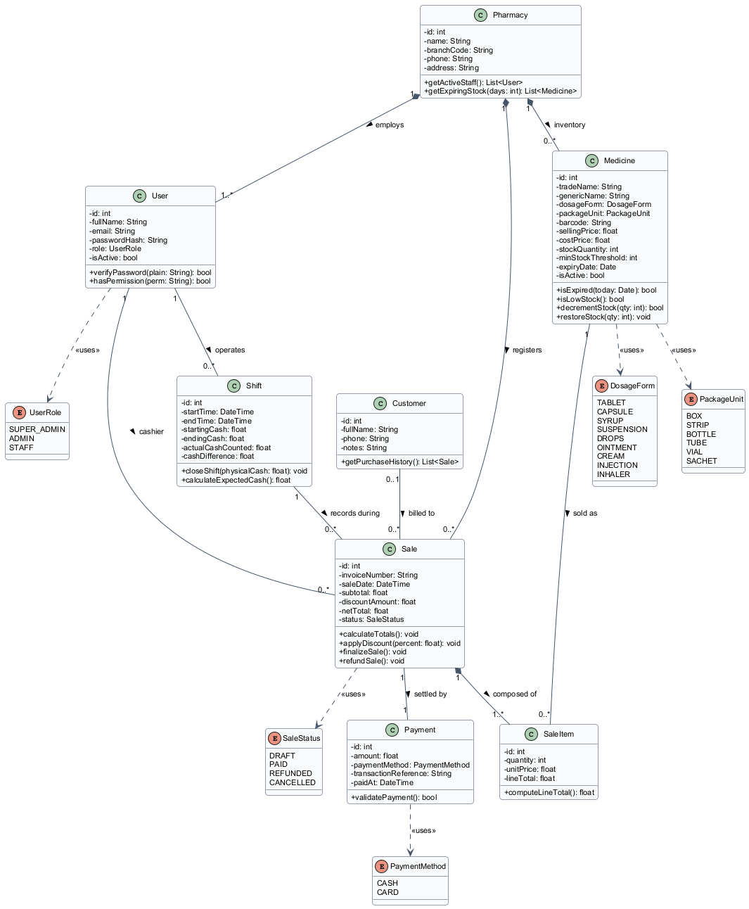

# Traceability Matrix — PharmaSys

**Course:** Software Engineering — Practical Lab 03: Modelling I  
**Faculty:** Faculty of Computers and Information, Damanhour University  
**Supervisor:** Prof. Dr. Amr Abohany  
**Author:** Abdelrahman Mahmoud Ali (@AbdelrahmanMahmoud312005) — System Architect  
**Project:** PharmaSys — SaaS Pharmacy Management Platform  

---

## 1. Overview & Purpose
This traceability matrix establishes a bidirectional mapping between the **Product Backlog User Stories** defined in [`docs/requirements.md`](requirements.md), the **Use Case Model** in [`docs/diagrams/source/use-case.puml`](diagrams/source/use-case.puml), and the **Domain Classes** in [`docs/diagrams/source/domain-classes.puml`](diagrams/source/domain-classes.puml).

It guarantees that every functional requirement has architectural representation and verifiable test coverage.

---

## 2. Requirements to Design Traceability Matrix

### 2.1 Core MVP Stories (Must Have)

| User Story ID & Title | Priority | Target Actor | Use Case Mapping | Domain Classes Involved | Test Verification Scenario |
|:---|:---:|:---|:---|:---|:---|
| **US-01** User Login and Authentication | **Must** | Staff / Admin | **UC-01** Authenticate & Log In | `User`, `Pharmacy`, `UserRole` | `Feature: User Login` (Positive login, invalid password, deactivated account) |
| **US-02** Role-Based Access Control | **Must** | Admin | **UC-01** Authenticate & Log In **UC-13** Manage Staff Accounts & RBAC | `User`, `UserRole` | `Feature: RBAC` (Role dependency guards, 403 on `/admin/*` routes) |
| **US-03** Add Medicines | **Must** | Admin | **UC-10** Manage Medicine Catalog | `Medicine`, `Pharmacy`, `DosageForm`, `PackageUnit` | `Feature: Add Medicines` (Valid creation, duplicate barcode 409, past expiry 422) |
| **US-06** Search Medicines | **Must** | Staff | **UC-02** Search & Inspect Medicines | `Medicine`, `Pharmacy`, `DosageForm` | `Feature: Search Medicines` (Trade/generic/barcode query, latency $< 2.0\text{ s}$) |
| **US-07** Scan Barcodes | **Must** | Staff | **UC-03** Process Sale at POS **UC-04** Validate Stock & Expiry | `Medicine`, `SaleItem`, `Sale` | `Feature: Barcode Scanning` (Scan to cart, expired blocked, out-of-stock blocked) |
| **US-08** Calculate Bills | **Must** | Staff | **UC-03** Process Sale at POS **UC-06** Apply Manager Discount | `SaleItem`, `Sale` | `Feature: Bill Calculation` (Subtotal, discount calculation, change calculation) |
| **US-10** Complete Sales and Generate Invoices | **Must** | Staff | **UC-03** Process Sale at POS **UC-05** Deduct Stock Atomically **UC-08** Print Invoices & Labels | `Sale`, `SaleItem`, `Payment`, `Medicine`, `Shift` | `Feature: Complete Sale` (Atomic stock decrement, paid status, 80mm receipt generation) |

---

### 2.2 Selected Supporting Stories (Should & Could Have)

| User Story ID & Title | Priority | Target Actor | Use Case Mapping | Domain Classes Involved | Test Verification Scenario |
|:---|:---:|:---|:---|:---|:---|
| **US-04** Update Medicines | **Should** | Admin | **UC-10** Manage Medicine Catalog | `Medicine` | Price/stock updates, catalog change propagation |
| **US-05** Delete Medicines | **Should** | Admin | **UC-10** Manage Medicine Catalog | `Medicine` | Soft delete flag, past invoice integrity preservation |
| **US-09** Record Customer Information | **Should** | Staff | **UC-03** Process Sale at POS | `Customer`, `Sale` | Patient name/phone attachment, invoice header rendering |
| **US-11** Manage Staff Shifts | **Should** | Staff | **UC-09** Manage Staff Shift & Drawer | `Shift`, `User` | Clock-in starting cash, clock-out duration and drawer balance |
| **US-12** Manage Inventory | **Should** | Admin | **UC-11** Monitor Inventory & Expiry Alerts | `Medicine`, `Pharmacy` | Color badges (yellow $< 90\text{ d}$, red $< 30\text{ d}$), low-stock thresholds |
| **US-13** Generate Sales Reports | **Should** | Admin | **UC-12** Generate Sales & Financial Reports | `Sale`, `SaleItem`, `Payment` | Daily/weekly revenue aggregations, export CSV |
| **US-15** Manage Staff Accounts | **Should** | Admin | **UC-13** Manage Staff Accounts & RBAC | `User`, `UserRole` | Admin creates staff credentials, deactivate account |
| **US-22** Drug-to-Drug Interaction Warning | **Could** | Staff | **UC-07** Alert Drug-to-Drug Interaction | `Medicine`, `SaleItem` | Interaction detection (e.g., Warfarin + Aspirin), critical warning banner |
| **US-25** Shift Handover and Cash Drawer Reconciliation | **Could** | Admin | **UC-09** Manage Staff Shift & Drawer | `Shift`, `Payment` | Expected cash vs actual counted cash audit log |

---

## 3. Visual Domain Class Model
The Domain Class Diagram is versioned as code in [`docs/diagrams/source/domain-classes.puml`](diagrams/source/domain-classes.puml) and exported as [`docs/diagrams/exports/domain-classes.png`](diagrams/exports/domain-classes.png).

