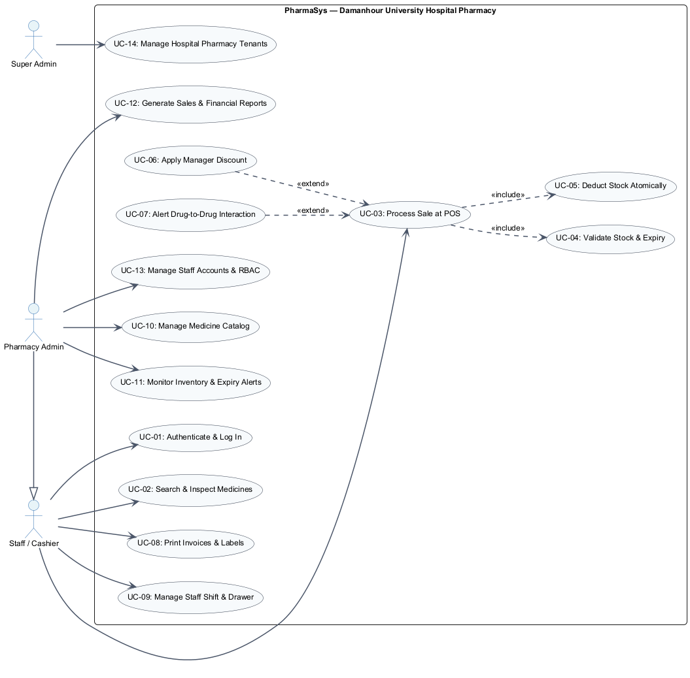

# Use Case Specifications — PharmaSys

**Course:** Software Engineering — Practical Lab 03: Modelling I  
**Faculty:** Faculty of Computers and Information, Damanhour University  
**Supervisor:** Prof. Dr. Amr Abohany  
**Author:** Abdelrahman Mahmoud Ali (@AbdelrahmanMahmoud312005) — System Architect  
**Project:** PharmaSys — SaaS Pharmacy Management Platform  

---

## 1. Overview of System Use Cases

The use case model captures the interactions between hospital actors and **PharmaSys**. The system prioritizes the **POS Counter Checkout** as the default operational workflow.

### Visual Model
The complete Use Case Diagram is maintained as code in [`docs/diagrams/source/use-case.puml`](diagrams/source/use-case.puml) and exported as [`docs/diagrams/exports/use-case.png`](diagrams/exports/use-case.png).

---

## 2. Fully-Dressed Use Case: UC-03 Process Sale at POS

| Field | Specification Details |
|:---|:---|
| **Use Case ID** | **UC-03** (Traceable to **US-07**, **US-08**, **US-10**) |
| **Use Case Name** | **Process Sale at POS (Counter Checkout & Invoicing)** |
| **Scope** | PharmaSys Application — Damanhour University Hospital Pharmacy Counter |
| **Level** | User-Goal Level (Primary Business Transaction) |
| **Primary Actor** | **Staff / Cashier (Counter Pharmacist)** |
| **Supporting Actors** | **Pharmacy Admin** (authorization on discounts), **Hardware Devices** (Barcode Scanner & Thermal Printer) |
| **Stakeholders & Interests** | 1. **Patient / Customer:** Wants rapid counter service, verified unexpired medications, and an itemized printed invoice for medical insurance. 2. **Cashier / Pharmacist:** Wants an auto-focused barcode input, automatic total calculation, and zero manual math errors. 3. **Pharmacy Admin:** Wants guaranteed atomic stock decrements, cash drawer auditing, and accurate revenue logs. |
| **Preconditions** | 1. Cashier is successfully authenticated with role `STAFF` or `ADMIN`. 2. An active `Shift` is open with logged starting cash. 3. Hardware USB barcode scanner is connected and recognized (keyboard emulation or WebHID). 4. POS screen is loaded with the barcode input field automatically focused. |
| **Postconditions** | 1. A new `Sale` record is created in the database with status `PAID`. 2. `SaleItem` records are generated linking each medicine, sold quantity, and snapshotted unit price. 3. `Medicine.stockQuantity` for each sold item decrements atomically. 4. A unique, sequentially generated invoice number (e.g., `INV-2026-00042`) is issued. 5. A formatted receipt is dispatched to the thermal printer (80mm) or A4 print modal. 6. Shift cash balance is incremented by the net sale amount. |
| **Trigger** | Cashier scans the barcode of the first medicine presented by the customer, or types a search query. |

---

### Main Success Scenario (Basic Flow)

1. **Scan Medicine:** The cashier scans the manufacturer barcode on the medicine package using the USB scanner.
2. **Catalog Validation (`<<include>> UC-04`):** The system queries the catalog by barcode, retrieves medicine details, verifies that `stockQuantity > 0`, and confirms `expiryDate > today`.
3. **Cart Addition:** The system adds the item to the active cart with quantity `1`, computes `lineTotal = quantity * unitPrice`, sounds an affirmative beep, and re-focuses the barcode input.
4. **Repeat for Items:** The cashier repeats Step 1 for all customer medications. If a barcode is scanned again, the system increments the existing line's quantity.
5. **Review Bill:** The cashier reviews the cart summary. The system automatically computes `subtotal`, applicable taxes, and `netTotal`.
6. **Customer Linking (Optional):** The cashier inputs the customer's name and mobile number for prescription tracking.
7. **Payment Selection:** The cashier selects the payment method (Cash or Card). For cash payments, the cashier inputs the amount tendered; the system computes and displays the required change.
8. **Finalize Sale (`<<include>> UC-05`):** The cashier confirms the sale (or presses shortcut `F2`). The system starts an atomic database transaction:
   - Sets sale status to `PAID`.
   - Decrements `Medicine.stockQuantity` for all items.
   - Commits the transaction.
9. **Receipt Dispatch:** The system opens the printable invoice modal and dispatches ESC/POS print commands to the 80mm thermal receipt printer.
10. **Cart Reset:** The system clears the cart and returns the cursor to the auto-focused barcode input, ready for the next patient.

---

### Extensions (Alternative & Exception Flows)

* **2a. Unrecognized Barcode Scanned:**
  - 1. System detects the barcode is not in the database.
  - 2. System flashes a red warning banner: *"Medicine not registered in catalog"*.
  - 3. Cart remains unaltered; cashier can perform a manual text search or register the medicine.

* **2b. Expired Medicine Detected:**
  - 1. System determines `expiryDate <= today`.
  - 2. System immediately blocks addition, displays a critical red alert: *"BLOCKED: Medication is expired (Expiry Date: YYYY-MM-DD)"*, and sounds a warning tone.
  - 3. Item is excluded from the cart to protect patient health.

* **2c. Out-of-Stock Medicine Scanned:**
  - 1. System determines `stockQuantity == 0`.
  - 2. System rejects addition and alerts: *"BLOCKED: Zero stock available"*.
  - 3. System offers a quick action: *"Find Generic Alternative"* (Extension to UC-02).

* **4a. Quantity Adjustment:**
  - 1. Cashier manually edits the quantity field on a cart line or clicks `+` / `-`.
  - 2. If requested quantity exceeds `stockQuantity`, system sets quantity to available stock and alerts the cashier.

* **5a. Manager Discount Requested (`<<extend>> UC-06`):**
  - 1. Cashier attempts to apply a special discount percentage.
  - 2. System prompts for Admin credentials.
  - 3. Admin enters password/PIN; system validates `ADMIN` permissions.
  - 4. Discount amount is subtracted, and `netTotal` recalculates.

* **5b. Drug-to-Drug Interaction Flagged (`<<extend>> UC-07`):**
  - 1. System cross-references active ingredients of cart items and detects a severe interaction.
  - 2. System renders an emergency alert banner displaying the risk (e.g., *"Warfarin + Aspirin: High bleeding risk"*).
  - 3. Cashier must check *"Acknowledge & Proceed"* before payment button is enabled.

* **7a. Insufficient Cash Tendered:**
  - 1. Cashier enters an amount less than `netTotal`.
  - 2. System keeps the "Confirm Sale" button disabled and displays remaining balance needed.

* **8a. Database Transaction / Printer Hardware Failure:**
  - 1. If power drops or database connection fails during commit, the transaction is rolled back completely (`ROLLBACK`).
  - 2. Stock levels remain untouched.
  - 3. System logs the error and displays an error dialog: *"Transaction failed — no stock was decremented"*.

---

### Special Requirements & Quality Attributes
1. **Ergonomic Speed:** Barcode lookup and cart line insertion must complete in **$\le 500 \text{ ms}$**.
2. **Zero-Mouse Checkout:** The entire checkout process (Scan $\to$ F2 Payment $\to$ Enter Confirm $\to$ Print) can be operated exclusively via keyboard shortcuts.
3. **Audit Trail:** Every completed sale records the exact timestamp, `cashier_id`, and `shift_id`.
